# Telepiplex 片源格式识别拓扑

本说明对应 Search 2.8.0。识别对象是搜索结果中的资源命名信息，包括标题、同资源排序标题和 magnet 的显示名；它们是资源声明，不是对实际视频文件的检测结果。

源码入口：`features/search/src/telepiplex_search/release_formats.py`。格式家族、正则、别名示例集中在声明式目录中。结果展示由 `release_report.py` 消费解析后的字段，不再单独维护另一套格式正则。

## 数据路径

```mermaid
flowchart TD
    A[资源标题] --> N[Unicode 与分隔符归一化]
    N --> C[声明式格式目录与声道语法]
    C --> V[分辨率 来源 编码 位深 动态范围 封装 帧率]
    C --> S[音频编码 声道 沉浸能力]
    F[同资源排序标题或 magnet dn] --> P[独立解析]
    V --> M[按字段检查冲突并补缺]
    S --> M
    P --> M
    M --> R[去重 规范标签 两行片源展示]
    M --> U[缺失字段保持未知]
```

## 识别边界

- “穷举”指对已声明的格式家族、别名、分隔符、组合和拒绝条件建立覆盖矩阵。资源名称是开放文本，无法承诺所有未来格式或随意拼写都能识别。
- 同一复合标记只消费一次，避免 `DTS-HD MA` 同时显示为 `DTS-HD` 和 `DTS`，也避免 HE-AAC 配置退化成额外的 AAC 标签。
- 只有显式证据才能提供声道、位深或 HDR。AAC、AC-4、TrueHD、Dual Audio、MKV、BT.2020、Main10 等标签不能互相推导能力。
- `v2.0`、码率、帧率、编解码器编号和片名中的小数不能作为声道证据。声道布局数字求和用于紧凑层级，例如 `5.1 → 6ch`、`7.1.4 → 12ch`，不表示已经测得真实扬声器布局或对象数量。
- 同资源补充信息只填缺失字段。分辨率、来源、编码、位深、动态范围、封装、帧率或已知声道矛盾时，拒绝该补充信息；先接受的补缺也参与后续冲突检查。
- 兼容细化不算冲突：如 `DV` 补充兼容的 HDR10 层、HDR 细化为 HDR10+、AAC 细化为 HE-AAC。DTS-HD MA 与 DTS-HD HRA 等同层配置不能互相替换。标题明确列出的独立音轨仍全部保留。
- 空缺字段保持未知；不根据文件体积、发布组、作品身份或下载后的另一个名称猜测参数。

## 格式目录

当前有限目录包含 **10 个维度、147 条规则、301 条登记别名样例**。同一拼写可以属于不同维度；下面完整列出所有标准标签及登记样例。大小写变体和分隔符语法不逐字重复列出。

### 分辨率与扫描方式（resolution）

| 标准展示标签 | 登记别名样例 |
| --- | --- |
| `1080p` | `4Kto1080p`、`2160p-to-1080p`、`1080p`、`1920x1080`、`FHD`、`FullHD` |
| `4320p` | `4320p`、`8K`、`7680x4320`、`8192×4320` |
| `2160p` | `2160p`、`4K`、`UHD`、`3840x2160`、`4096×2160` |
| `1440p` | `1440p`、`2560x1440` |
| `1080i` | `1080i` |
| `720p` | `720p`、`1280x720` |
| `576p` | `576p`、`720x576` |
| `576i` | `576i` |
| `540p` | `540p` |
| `480p` | `480p`、`640x480`、`720x480` |
| `480i` | `480i` |
| `360p` | `360p`、`640x360` |
| `240p` | `240p`、`320x240`、`426x240` |

### 片源来源（source）

| 标准展示标签 | 登记别名样例 |
| --- | --- |
| `REMUX` | `REMUX`、`BDRemux`、`UHDRemux`、`WEBRemux` |
| `WEBMux` | `WEBMux`、`WEB-DLmux` |
| `WEB-DL` | `WEB-DL`、`WEB.DL`、`WEBDL` |
| `WEBRip` | `WEBRip`、`WEB-Rip` |
| `BluRay` | `BluRay`、`Blu-Ray`、`BDRip`、`UHDBDRip`、`BRRip`、`BDISO`、`BDMux`、`BD50`、`BDLight`、`BD`、`蓝光`、`藍光` |
| `HD-DVD` | `HD-DVD`、`HDDVDRip` |
| `HDTV` | `HDTV`、`HDTVRip`、`UHDTV` |
| `PDTV` | `PDTV` |
| `SDTV` | `SDTV` |
| `TVRip` | `TVRip` |
| `DSR` | `DSR`、`DSRip` |
| `DVDSCR` | `DVDSCR`、`DVDScreener`、`Screener` |
| `DVD` | `DVD`、`DVDRip`、`DVD9` |
| `VHS` | `VHS`、`VHSRip` |
| `VCD` | `VCD`、`SVCDRip` |
| `CAM` | `CAM`、`HDCAM`、`CAMRip` |
| `TELESYNC` | `HDTS`、`HD-TS`、`TELESYNC` |
| `TELECINE` | `HDTC`、`HD-TC`、`TELECINE` |
| `WORKPRINT` | `WORKPRINT`、`Work-Print` |

### 视频编码（video_codec）

| 标准展示标签 | 登记别名样例 |
| --- | --- |
| `HEVC` | `HEVC`、`H.265`、`H265`、`x265` |
| `AVC` | `AVC`、`H.264`、`H264`、`x264` |
| `AV1` | `AV1`、`AV01` |
| `VVC` | `VVC`、`H.266`、`x266` |
| `VP9` | `VP9`、`VP-9` |
| `VP8` | `VP8`、`VP-8` |
| `VC-1` | `VC-1`、`VC1`、`WMV3`、`WVC1` |
| `MPEG-2` | `MPEG2`、`MPEG-2`、`H.262` |
| `MPEG-1` | `MPEG1`、`MPEG-1` |
| `Xvid` | `Xvid` |
| `DivX` | `DivX` |
| `MPEG-4` | `MPEG4`、`MPEG-4 ASP`、`MP4V` |
| `AVS3` | `AVS3` |
| `AVS2` | `AVS2` |
| `AVS` | `AVS1`、`CAVS` |
| `FFV1` | `FFV1` |
| `ProRes` | `ProRes`、`ProRes 422 HQ`、`ProRes4444` |
| `Theora` | `Theora` |
| `RealVideo` | `RealVideo`、`RV40` |
| `WMV` | `WMV`、`WMV2` |
| `H.263` | `H.263`、`H263` |
| `MJPEG` | `MJPEG`、`Motion JPEG` |

### 显式视频位深（bit_depth）

| 标准展示标签 | 登记别名样例 |
| --- | --- |
| `8bit` | `8bit`、`8-bit`、`yuv420p8le` |
| `10bit` | `10bit`、`10-bit`、`yuv420p10le`、`Hi10P`、`High10P`、`P010`、`P010LE` |
| `12bit` | `12bit`、`12-bit`、`yuv420p12le`、`P012`、`P012LE` |
| `16bit` | `16bit`、`16-bit`、`yuv420p16le` |

### 动态范围（dynamic_range）

| 标准展示标签 | 登记别名样例 |
| --- | --- |
| `DV` | `DV`、`DoVi`、`Dolby Vision`、`杜比视界` |
| `HDR10+` | `HDR10+`、`HDR10Plus`、`HDR10P`、`HDR 10 Plus`、`HDR10+DV` |
| `HDR10` | `HDR10`、`HDR-10` |
| `HDR` | `HDR` |
| `HLG` | `HLG`、`Hybrid Log Gamma` |
| `SDR` | `SDR` |

### 封装（container）

| 标准展示标签 | 登记别名样例 |
| --- | --- |
| `MKV` | `MKV`、`Matroska` |
| `MP4` | `MP4` |
| `M4V` | `M4V` |
| `AVI` | `AVI` |
| `MOV` | `MOV`、`QuickTime` |
| `WebM` | `WebM` |
| `M2TS` | `M2TS`、`MTS` |
| `MPEG-TS` | `MPEG-TS` |
| `MPEG-PS` | `MPEG-PS`、`VOB` |
| `FLV` | `FLV` |
| `ASF` | `ASF` |
| `WMV` | `WMV` |
| `RMVB` | `RMVB`、`RM` |
| `OGM` | `OGM`、`OGV` |
| `ISO` | `ISO` |

### 帧率（frame_rate）

| 标准展示标签 | 登记别名样例 |
| --- | --- |
| `23.976fps` | `23.976fps`、`24000/1001fps` |
| `23.98fps` | `23.98fps` |
| `24fps` | `24fps` |
| `25fps` | `25fps` |
| `29.97fps` | `29.97fps`、`30000/1001fps` |
| `30fps` | `30fps` |
| `48fps` | `48fps` |
| `50fps` | `50fps` |
| `59.94fps` | `59.94fps`、`60000/1001fps` |
| `60fps` | `60fps` |
| `100fps` | `100fps` |
| `119.88fps` | `119.88fps`、`120000/1001fps` |
| `120fps` | `120fps` |
| `144fps` | `144fps` |
| `240fps` | `240fps` |

### 音频编码与配置（audio_codecs）

| 标准展示标签 | 登记别名样例 |
| --- | --- |
| `TrueHD` | `TrueHD`、`True-HD`、`Dolby TrueHD` |
| `DTS-HD MA` | `DTS-HD MA`、`DTS-HDMA`、`DTSMA`、`DTS Master Audio` |
| `DTS-HD HRA` | `DTS-HD HRA`、`DTSHDHRA`、`DTS-HD High Resolution Audio` |
| `DTS-HD` | `DTS-HD`、`DTSHD` |
| `DTS:X Pro` | `DTS:X Pro`、`DTS-X-Pro` |
| `DTS:X` | `DTS:X`、`DTS-X`、`DTSX` |
| `DTS-ES` | `DTS-ES`、`DTSES`、`DTS ES Discrete` |
| `DTS96/24` | `DTS96/24`、`DTS 96-24` |
| `DTS` | `DTS` |
| `DD+` | `EAC3`、`E-AC-3`、`DDP`、`DD+`、`Dolby Digital Plus` |
| `DD` | `AC3`、`AC-3`、`DD`、`Dolby Digital` |
| `AC-4` | `AC4`、`AC-4` |
| `MLP` | `MLP` |
| `FLAC` | `FLAC` |
| `PCM` | `LPCM`、`PCM`、`PCM S24LE` |
| `HE-AAC` | `HE-AAC`、`HE-AACv2`、`AAC-HE`、`AAC-SBR`、`AAC+`、`AAC++`、`AACplus`、`eAAC+` |
| `AAC` | `AAC`、`AAC-LC`、`LC-AAC`、`MPEG4 AAC`、`MPEG-4 AAC` |
| `ALAC` | `ALAC`、`Apple Lossless` |
| `Opus` | `Opus` |
| `Vorbis` | `Vorbis` |
| `MP3` | `MP3`、`MPEG Layer III` |
| `MP2` | `MP2`、`MPEG Layer II` |
| `MP1` | `MP1`、`MPEG Layer I` |
| `WavPack` | `WavPack` |
| `TTA` | `TTA`、`True Audio` |
| `APE` | `APE`、`Monkey's Audio` |
| `WMA` | `WMA`、`WMA Pro`、`WMA Lossless` |
| `DSD` | `DSD`、`DSD128`、`DST` |
| `RealAudio` | `RealAudio`、`RAAC`、`RALF` |

### 声道词汇（channels）

| 标准展示标签 | 登记别名样例 |
| --- | --- |
| `2ch` | `Stereo`、`立体声`、`立體聲`、`Binaural` |
| `1ch` | `Mono`、`单声道`、`單聲道` |
| `4ch` | `Quad`、`Quadraphonic` |

### 沉浸标记（immersive）

| 标准展示标签 | 登记别名样例 |
| --- | --- |
| `Atmos` | `Atmos`、`Dolby Atmos`、`杜比全景声` |
| `DTS:X` | `DTS:X`、`DTSX`、`DTS:X Pro` |
| `Auro-3D` | `Auro3D`、`Auro-3D` |

### 声道数与布局语法

| 写法 | 范围与解释 |
| --- | --- |
| 显式数量 | `1CH`–`32CH`，以及 `channel/channels/声道/聲道` 后缀；`2CH → 2ch立体`，`6CH → 6ch环绕`。 |
| 布局 | `主声道.LFE[.高度声道]`；主声道 1–22、LFE 0–2、高度 0–8，总数按显式数字求和。覆盖 `1.0`、`2.0`、`2.1`、`3.0`、`3.1`、`4.0`、`4.1`、`5.0`、`5.1`、`6.0`、`6.1`、`7.0`、`7.1`、`22.2` 及高度组合。 |
| 紧凑布局 | 紧跟已识别音频编码的 `10/20/21/30/31/40/41/50/51/60/61/70/71`，如 `DD51 → 6ch`；孤立整数不采用此解释。 |
| 高度示例 | `3.1.2 → 6ch`、`5.1.2 → 8ch`、`5.1.4 → 10ch`、`7.1.2 → 10ch`、`7.1.4 → 12ch`、`9.1.6 → 16ch`。 |
| 多轨 | 同一资源有多个明确布局时，紧凑层级使用最大的显式总声道数；保留独立音频编码标签。 |

布局需要技术后缀、相邻音频标记、明确声道后缀或纯布局文本等证据。先遮蔽编码名称和带单位的数值，再解析声道，防止 `AC3.5.1`、`DTS96/24.5.1` 被数字交叠吞掉，也防止 `7.1.3.0Mbps` 把码率数字吃成高度声道。

### 复合标记与细化关系

| 父标签 | 可接受的明确细化 |
| --- | --- |
| `AAC` | `HE-AAC` |
| `DTS-HD` | `DTS-HD MA`、`DTS-HD HRA` |
| `DTS` | `DTS-HD`、`DTS-ES`、`DTS96/24`、`DTS:X` |
| `DTS:X` | `DTS:X Pro` |

这些关系仅用于合并同资源标题的兼容证据，不允许从父格式猜测子格式。HDR10+ 可细化 HDR10/HDR；DV 可以与明确的 HDR10/HDR10+/HLG 层共存，DV 本身不补出底层格式。SDR 与 HDR 证据冲突，明确 HLG 与 HDR10 系列也不能跨标题混合。

`DD+` 加明确 `JOC` 可确认沉浸能力；孤立 JOC、AC-4 或 DTS-HD 不推导沉浸。裸 `TS` 不当作摄录来源，仅终端 `.ts` 识别为 MPEG-TS 封装；WEBMux 保留独立来源标签。

### 附加语法与拒绝规则

- 常见 `fps` 样例见帧率表；额外接受显式 1–240 fps、最多三位小数及 `frames per second/frame/s` 写法。`1080p60`、`1080i50`、`2160p23.976` 同时提供扫描模式与帧率；没有扫描模式标记时，普通数字不提供帧率。
- 显式扫描模式优先于同名称中的泛化像素尺寸；裁切尺寸如 `1920x800` 不改写成 1080p。`4Kto1080p` 采用实际输出的 1080p。
- 大小写、全角字符、空格、点、下划线、短横线和常见长横线统一处理；技术标签可以紧贴汉字。复合别名内部也接受相应分隔符。
- 歧义词在年份、季集或分辨率之前默认按作品标题处理；独立词条和明确括号技术标签保留。防止把电影 `Ape`、`Cam`、`Opus` 当作 APE 音轨、CAM 来源或 Opus 音轨。
- 编码 Level、DV Profile、版本、年份、帧率、采样率和码率不提供声道。音频的 16bit 不进入视频位深；终端 `.wmv` 是封装证据，`MPEG-4 AAC` 是音频复合名称。

### 规范参考

- 编码家族参照 [Matroska codec mappings](https://www.matroska.org/technical/codec_specs.html)。
- 显式像素位深与声道布局参照 FFmpeg 的 [pixel formats](https://github.com/FFmpeg/FFmpeg/blob/master/libavutil/pixfmt.h) 和 [channel layouts](https://github.com/FFmpeg/FFmpeg/blob/master/libavutil/channel_layout.c)。
- JOC 与 AC-4 的沉浸条件参照 Dolby 的 [DD+ JOC](https://professionalsupport.dolby.com/s/article/What-is-Dolby-Digital-Plus-JOC-Joint-Object-Coding) 和 [AC-4 Atmos detection](https://webapi.streaming.dolby.com/v0_9/help_files/topics/atmos_in_ac4__1.html)。
- 上游资料用于核对格式语义，不引入按来源默认分辨率、按容器默认编码等推断。

## 展示约定

规格顺序为：分辨率 → 来源 → 动态范围 → 视频编码 → 位深 → 封装 → 帧率 → 版本 → 音频编码 → 声道/沉浸层级。没有提供的可选字段不占位置；声道未知仍显示 `?ch`，已知沉浸但声道未知显示 `?ch沉浸`。每个片源保持两行，第二行继续显示大小和活跃状态。

格式目录扩展只影响规格识别与展示，不改变搜索排序、下载链接、资源按钮身份、作品元数据合同或 Rename 的文件操作。

## 验证

别名和分隔符遍历测试保存在 `features/search/tests/test_release_formats.py`；独立书写预期值的实际展示组合矩阵保存在 `test_release_format_matrix.py`；已有 `test_release_report.py` 验证历史日志案例与展示合同。实际测试结果、命令和文件清单见 [本次交付](audits/2026-11-02-format-topology.md)。
